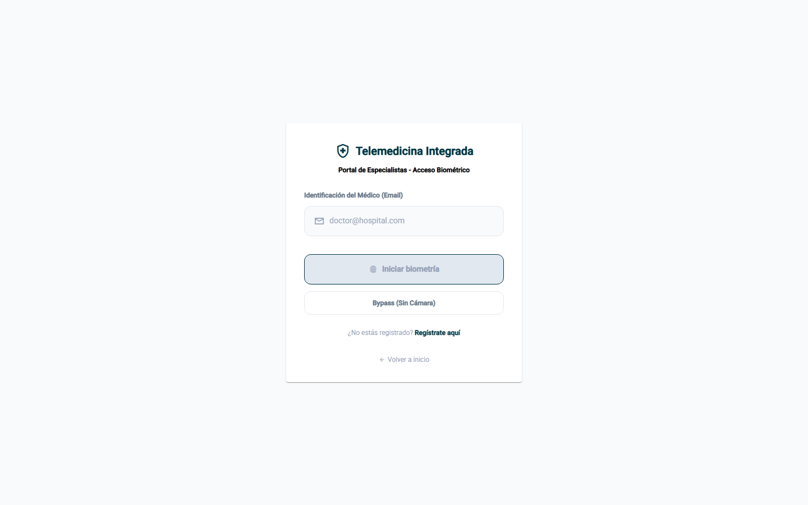
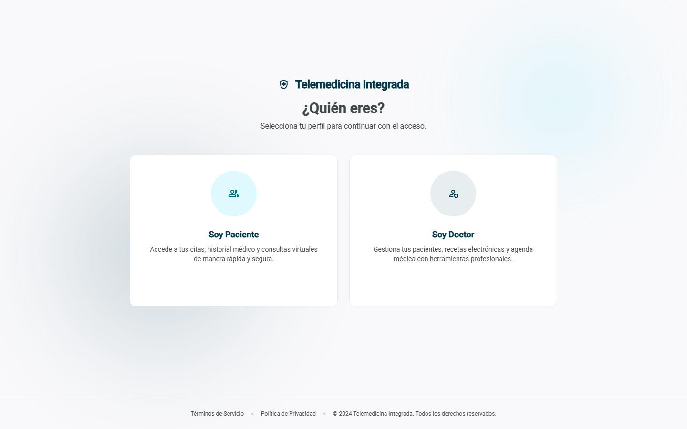
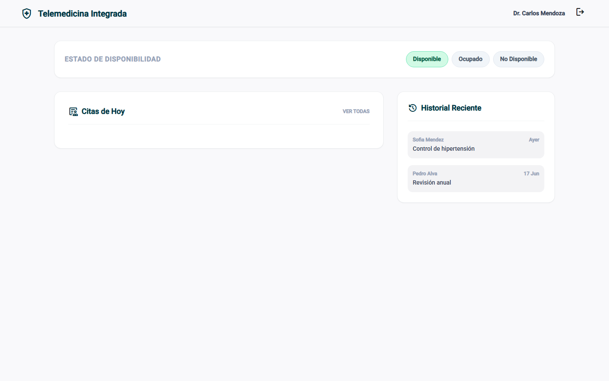
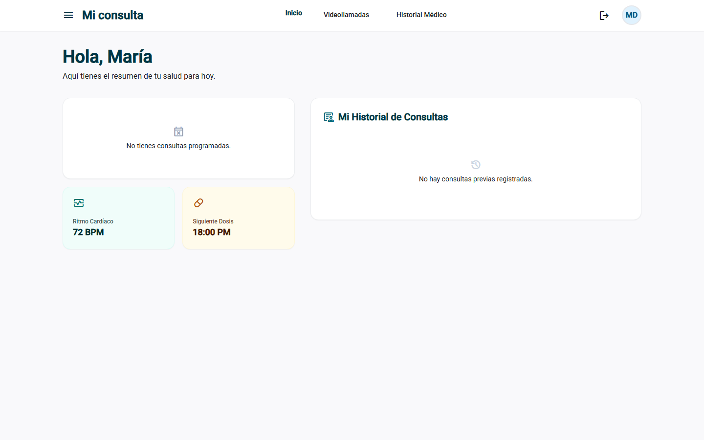

<p align="center">
  <a href="https://github.com/Nakusuo"></a>
</p>

# Telemedicina Integrada · Frontend

Una clínica en el navegador: médicos y pacientes **entran con su cara**, agendan citas, revisan su historial y se conectan por **videollamada**.

Lo hicimos en equipo para el curso de **Laboratorio de Integración de Sistemas** (UTP). Este repo es el portal web en Angular; la API está en [Backend-ClinicaBiometrica](https://github.com/Nakusuo/Backend-ClinicaBiometrica).

<p align="center">
  
</p>

## Cómo funciona el login con la cara

En vez de contraseña, la página prende la cámara y usa **face-api.js** para detectar el rostro y convertirlo en un vector de números (un *embedding*). Ese vector viaja al backend, que lo compara con el que se guardó al registrarse: si se parecen lo suficiente, entras. La foto nunca sale del navegador, solo los números.

Para probarlo sin cámara hay un botón **Bypass (Sin Cámara)**.

## Dos portales, uno para cada lado

Al entrar eliges quién eres, y la app te lleva a tu propio espacio:

| Elegir perfil | Panel del médico | Panel del paciente |
|---|---|---|
|  |  |  |

- **Médico**: marca si está disponible, ve sus citas del día y el historial reciente, abre el expediente de cada paciente y escribe la consulta.
- **Paciente**: ve sus próximas consultas, su historial médico y entra a sus videollamadas.

## Con qué está hecho

Angular + TypeScript, Tailwind CSS, face-api.js para la biometría y WebRTC para las videollamadas. Las rutas internas están protegidas con un guard de sesión.

```text
src/app/
├── components/   # login, role-selector, dashboard, patient-dashboard,
│                 # expedient, expedient-editor, videocall, registros...
├── services/     # auth, api, biometric (face-api.js), webrtc
├── guards/       # protección de rutas
└── models/       # paciente, doctor, cita, expediente
```

## Cómo correrlo

Necesitas Node.js 18+ y el [backend](https://github.com/Nakusuo/Backend-ClinicaBiometrica) corriendo en `http://localhost:8000`.

```bash
npm install
npm start          # http://localhost:4200
```

Si tu backend está en otra dirección, cámbiala en `src/environments/environment.ts` (`apiUrl` y `wsUrl`).

El backend trae datos de prueba: el médico `doctor@email.com` y la paciente `maria@email.com`, ambos con contraseña `password123`.

<details>
<summary>Otros comandos</summary>

```bash
npm run build      # build de producción en dist/
npm test           # tests
```

</details>
